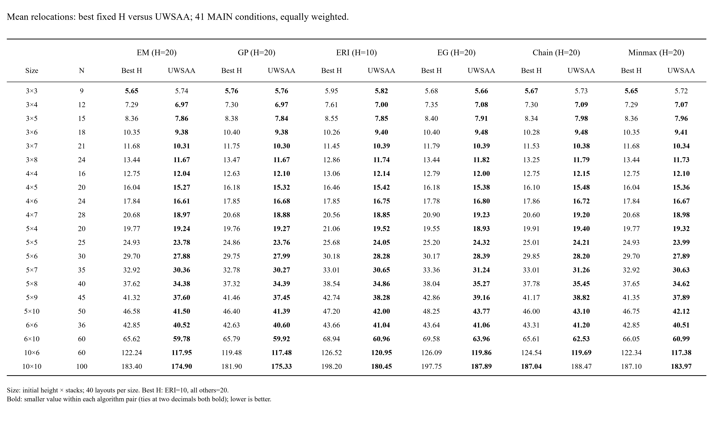
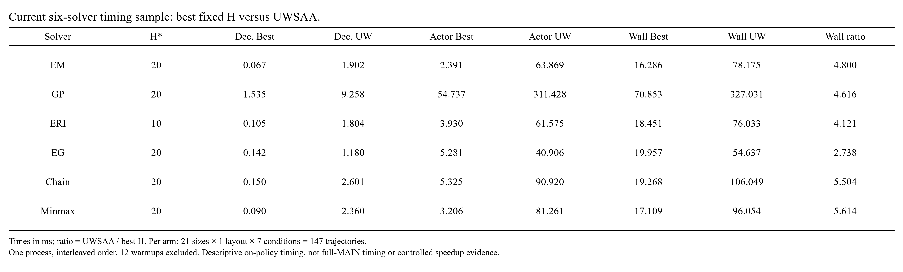

# Uniform-Width Sample-Average Approximation (UW-SAA)

This repository contains UWSAA, adapters for EM, GP, ERI, EG, Chain and Minmax, the online container-relocation environment, and reproducible Caserta evaluation results.

## Six-solver MAIN

The MAIN comparison uses each solver's **preselected best fixed horizon versus UWSAA**: **ERI H=10**, and **EM, GP, EG, Chain and Minmax H=20**. These are frozen development/training selections, not horizons selected on Caserta or separately for each evaluation condition.

The [complete MAIN package](results/best-h-main-20261028/README.md) covers **41 conditions × 840 layouts × six solvers × two arms = 413,280 endpoints**. There are 21 size classes, from 3×3 to 10×10, with 40 layouts per class. Size denotes initial height × number of stacks. The missing 28,560 ERI H10 baseline endpoints were completed without changing UWSAA or its parameters; 147 historical probe endpoints matched exactly.



- [Main table PDF](results/best-h-main-20261028/tables/table_main41_best_h_vs_uwsaa.pdf) · [LaTeX](results/best-h-main-20261028/tables/table_main41_best_h_vs_uwsaa.tex) · [CSV](results/best-h-main-20261028/tables/table_main41_best_h_vs_uwsaa.csv)
- [Wider absolute-cost figure](results/best-h-main-20261028/figures/absolute_relocations_wide_main41.pdf) · [Local zoom by initial height](results/best-h-main-20261028/figures/absolute_relocations_local_zoom_main41.pdf)
- [Full row-level MAIN data](results/best-h-main-20261028/data/six_solver_best_h_main_endpoints.csv.gz) · [Compact keyed matrix](results/best-h-main-20261028/data/validated_best_h_main_arrays.npz)
- [Family-effect intervals](results/best-h-main-20261028/figures/family_effects_best_h_ci.pdf) · [All statistical results](results/best-h-main-20261028/data/size_solver_effects.csv)

The primary noisy-forecast effect is the equal-weight average of SS, TW and DP family-specific relative reductions. Under this estimand, relocation reductions are EM 7.15%, GP 6.63%, ERI 7.97%, EG 6.85%, Chain 4.10%, and Minmax 6.03%. The displayed MAIN absolute-cost table instead averages all 41 conditions equally; those two aggregations must not be substituted for each other. CLEAN losses and size-level negative results are retained. Intervals are pointwise paired-layout bootstrap intervals, not simultaneous significance claims.

## Timing

The [current six-solver timing table](results/best-h-main-20261028/tables/timing_current_six_solvers.pdf) uses the same current runtime and frozen horizons in one process, interleaving solver/arm combinations within each sampled layout-condition cell. It covers one fixed layout per size and seven auxiliary conditions: **147 trajectories per arm per solver, 1,764 scored trajectories total**, with 12 warmups excluded. Every outcome matched its MAIN counterpart.



[Timing by size](results/best-h-main-20261028/tables/timing_current_by_size.pdf) and [timing CSV](results/best-h-main-20261028/tables/timing_current_six_solvers.csv) are included. This is descriptive on-policy timing of a stratified sample, **not full-MAIN timing**. It has no hardware-load control or confidence interval. Retired-GP timings are not substituted for current GP measurements.

## Historical ablation

The [historical ablation package](results/historical-ablation-20261021/README.md) preserves the previously completed component/window, deterministic-single, and scenario-count/rollout ablations, with their original tables, intervals and evidence provenance.

**Its GP and MEAN6 values belong to the retired GP version.** They are historical results, not ablations of the replacement GP or of the current six-solver MAIN package. Replacement-GP ablation/P0/multi-K runs remain canceled; no such new ablation results are claimed.

## Run and verify

Use Python 3.12 and install `requirements-results.txt`.

```bash
python -B checks/verify_published_files.py
python -B checks/verify_six_solver_results.py
python -B -m checks.verify_gp_results
python -B checks/independent_gp_main_review.py
```

The independent GP review verifies raw GP endpoints, published statistics, model/source identity, and train/evaluation layout separation. Per-seed training receipts are kept outside the public repository. Rechecking the 30-seed selection requires `--training-receipts /path/to/archived/20261024_formal_30seed`; without that argument, its report explicitly marks seed-receipt verification as not run. The retained 2026-10-25 review receipt records the earlier full check and does not imply that removed files remain distributed.

To recreate figures from the published inputs:

```bash
python results/best-h-main-20261028/scripts/generate_figures.py --output-dir work/main-figures
python results/historical-ablation-20261021/scripts/generate_figures.py --output-dir work/ablation-figures
```

The [registered trajectory runner](reproducibility/runner.py) remains executable. The active GP is trained seed 5, H20 in `configs/gp_rule.json`, using the MIT-licensed Python reproduction attributed to Narek Sergeyan, not the original authors' implementation. Frozen runtime code, the model, and the minimal protocol/training-bank inputs used by its identity checks remain public; detailed seed receipts, intermediate selection outputs and training logs are not distributed.

Caserta is the evaluation benchmark held out from UWSAA method development. The training-bank GP selection is not independent validation, and these results do not establish OOD generalization. See the [protocol](reproducibility/PROTOCOL.md), [result inventory](results/README.md), and [GP-only numerical review](results/gp-caserta-main-20261024/REVIEW.md) for the respective evidence boundaries.
