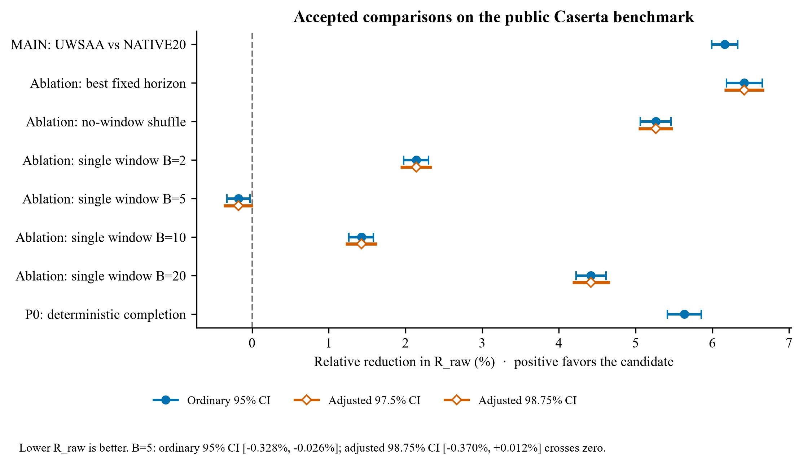
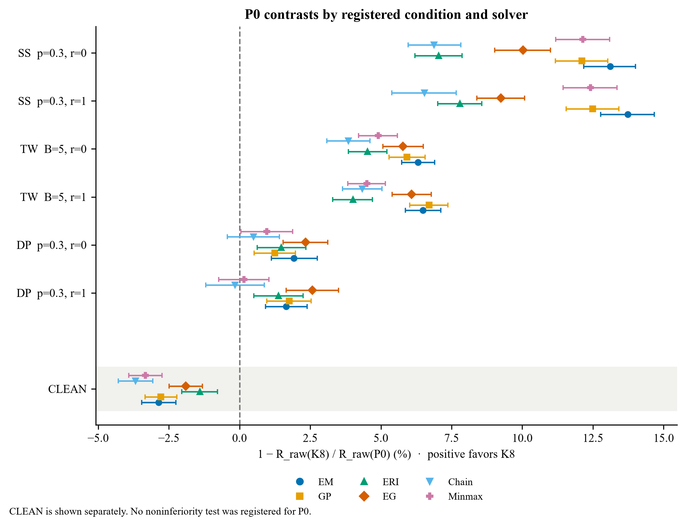
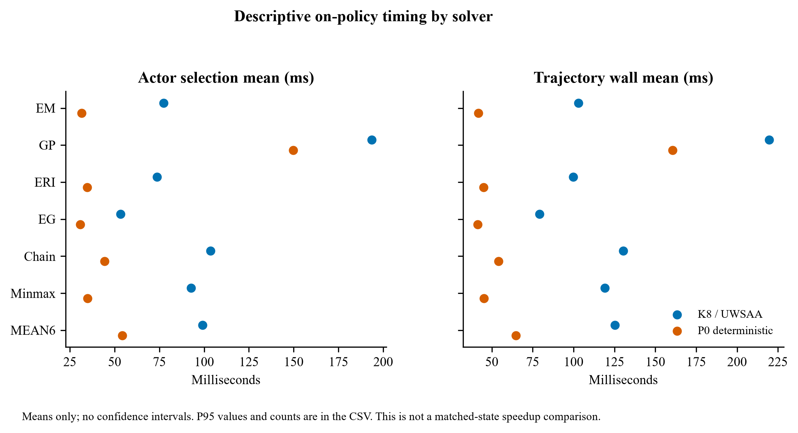

# Accepted Benchmark Evaluation Results

This package is a snapshot of the accepted condition-level and solver-level results for UW-SAA on the public Caserta benchmark; ongoing experiments are not included. It provides the result tables, a compact set of figures, and a script that regenerates those figures from the included CSV files.

Caserta is a public benchmark previously evaluated in other project routes. Relative to DEV100, this method and protocol were frozen before the Caserta run, which served as a confirmation holdout; the record states that no tuning or method selection was based on Caserta. This is confirmation evidence for the frozen method and protocol, but because the benchmark is public and was evaluated elsewhere in the project, it is not a sealed test set, does not show that the wider project had never encountered Caserta, and is not out-of-distribution evidence. The package provides accepted summaries; it does not include full trajectory-level data or a complete benchmark runner.

## Statistical scope

The statistical unit is the layout: 840 layouts across 21 geometry groups, with 40 layouts per geometry. MEAN6 is the equal-weight average across six solver estimates. It is an aggregate, not six repeated observations.

R_raw is the primary endpoint for the accepted comparisons; lower R_raw is better. The accepted-comparison table reports relative reduction in percent, where positive values favor the candidate. The condition-statistics tables retain both R_raw and R_over_N. Their estimates and confidence interval fields are proportions, not percentages; blank interval fields remain blank.

The eight accepted primary comparisons are the MAIN comparison against NATIVE20, six ablations, and the P0 deterministic-completion comparison. The 56-row table includes all six solvers and MEAN6 for each comparison. Ordinary 95% confidence intervals are retained for every comparison; adjusted intervals are included where available.

The B=5 ablation has an ordinary 95% interval of [-0.328%, -0.026%] and an adjusted 98.75% interval of [-0.370%, +0.012%]. The ordinary interval is below zero, while the adjusted interval crosses zero. This result does not support a claim that UW-SAA beats every single-window baseline.

## MAIN CLEAN noninferiority

On MAIN CLEAN, the registered 1% noninferiority test passed for MEAN6. The all-six-solver Bonferroni noninferiority gate failed; ERI alone met that conservative gate. The solver-level results and existing intervals are included in the MAIN condition-statistics CSV.

## P0 results

The P0 primary comparison combines the three noisy families SS, TW, and DP; it excludes CLEAN. Its MEAN6 relative reduction in R_raw is 5.633% (ordinary paired 95% CI [5.415%, 5.855%]).

The P0 condition table contains all seven registered conditions and all six solvers plus MEAN6. The figure shows the 42 solver-condition estimates and their existing ordinary 95% intervals. Positive values of 1 - R_raw(K8) / R_raw(P0) favor K8; negative values favor P0.

P0 CLEAN is shown separately. Its MEAN6 contrast is -2.657% (ordinary 95% CI [-2.985%, -2.322%]); all six solver estimates are negative. No noninferiority test was registered for P0, so this is a reported contrast rather than a pass/fail noninferiority result.

## Descriptive timing

Timing is descriptive on-policy timing. The table includes means, p95 values, counts, and sums for actor selection and full-trajectory wall time. It contains no confidence intervals and is not a matched-state speedup comparison.

## Registered work not run

The full P1 matrix was **NOT_RUN_BUDGET_GATE**. P2 was not run.

## Files

| File | Contents |
| --- | --- |
| data/accepted_primary_contrasts_all_solvers.csv | 56 accepted solver and MEAN6 comparisons |
| data/caserta_main_condition_effects.csv | All retained MAIN condition-statistics rows, both endpoints |
| data/caserta_ablation_condition_effects.csv | All retained ABLATION condition-statistics rows, both endpoints |
| data/p0_condition_solver_results.csv | Seven conditions × six solvers, plus MEAN6 |
| data/p0_k8_timing_by_solver.csv | Descriptive timing summaries, including MEAN6 |
| figures/ | PNG and vector PDF versions of the figures |
| scripts/generate_figures.py | Recreates the figures from the included CSV files |
| source_hash_manifest.json | Source and published artifact SHA-256 values |

To regenerate the figures from the repository root, install Matplotlib and NumPy, then run:
python results/accepted-benchmark-evaluation/scripts/generate_figures.py

The package does not include complete raw trajectories or a full benchmark runner. It supports inspection and visualization of the accepted summaries; it does not independently reproduce trajectory generation or the full evaluation.
