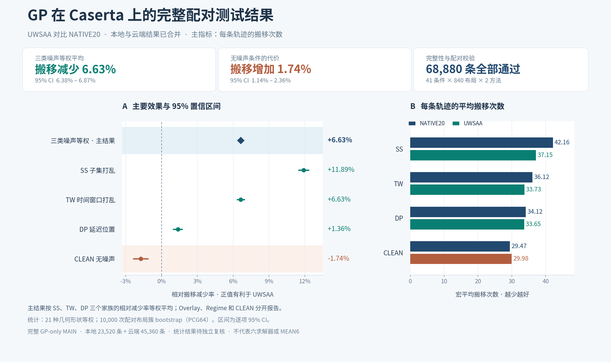

# Caserta GP 完整配对测试结果（2026-10-24）

本地与云端共 **68,880 条正式记录**已合并并通过完整性、哈希和配对校验：41 条件 × 840 布局 × 2 方法。

UWSAA 相比 NATIVE20，SS/TW/DP 三类噪声的家族效果等权平均为 **搬移减少 6.63%**（95% CI：6.38%–6.87%）；CLEAN 无噪声条件下搬移增加 1.74%（95% CI：1.14%–2.36%）。本次为 GP-only MAIN，统计状态保留 `pending_review`，尚未进行独立科学复核。

## 查看与下载

- [查看全部 41 条件图](gp_caserta_all_conditions.png)
- [下载概览 PDF](gp_caserta_summary.pdf?raw=true)
- [下载全部条件 PDF](gp_caserta_all_conditions.pdf?raw=true)
- [下载完整结果包（约 10.6 MB，含本地与云端原始记录）](gp_caserta_full_results.zip?raw=true)
- [下载分析图表包（约 0.85 MB）](gp_caserta_complete_analysis.zip?raw=true)
- [查看详细说明](结果说明.md)
- [家族与总体统计表](family_effects.csv) · [41 条件统计表](condition_effects.csv) · [汇总表](summary.csv)
- [合并校验回执](merge_integrity.json) · [分析清单](analysis_manifest.json) · [文件 SHA-256](SHA256SUMS.txt)

如手机内置浏览器无法下载，使用系统浏览器打开链接，或进入文件页面点击 Download raw file。

## 方法与边界

主指标为每条轨迹的搬移次数；先在每布局内平均家族条件，再平均几何内布局、等权平均 21 个几何，计算各家族相对减少率，最后等权平均 SS、TW、DP 的效果。Overlay、Regime、CLEAN 分开报告。区间使用注册的 10,000 次 PCG64 配对布局簇 bootstrap，seed 202610195903，为逐项 percentile 95% CI。

本地条件 1–14 共 23,520 条，云端条件 15–41 共 45,360 条；252 条跨主机探针仅作诊断，不计入正式结果。模型与数据绑定于 PR #9 的提交 e7bc170。其他五求解器未重跑，不产生 MEAN6 或全六求解器结论。
