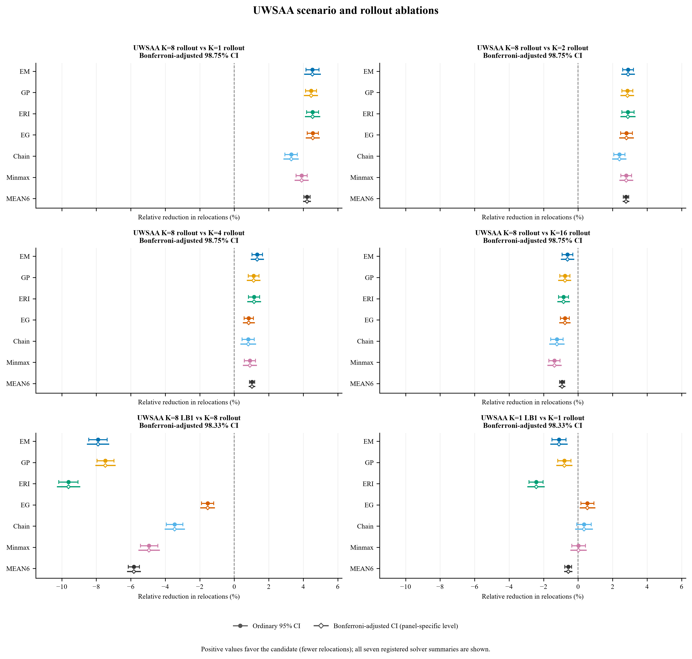
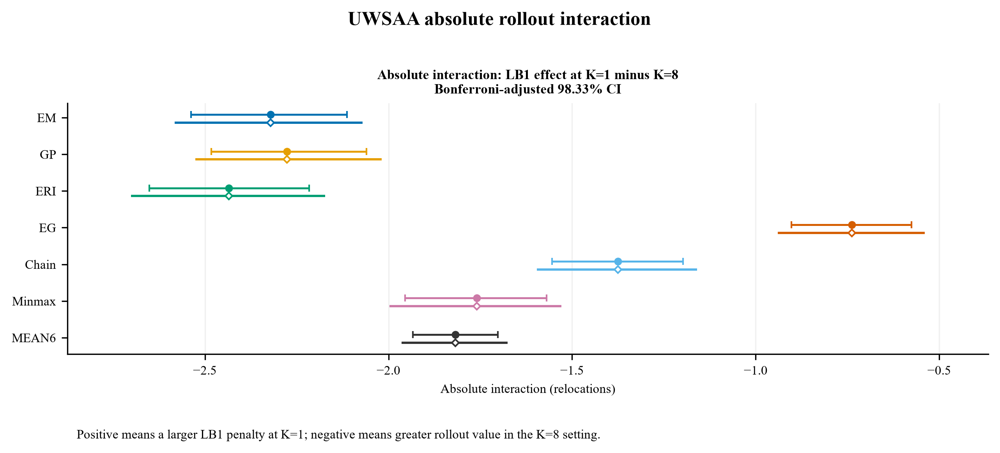
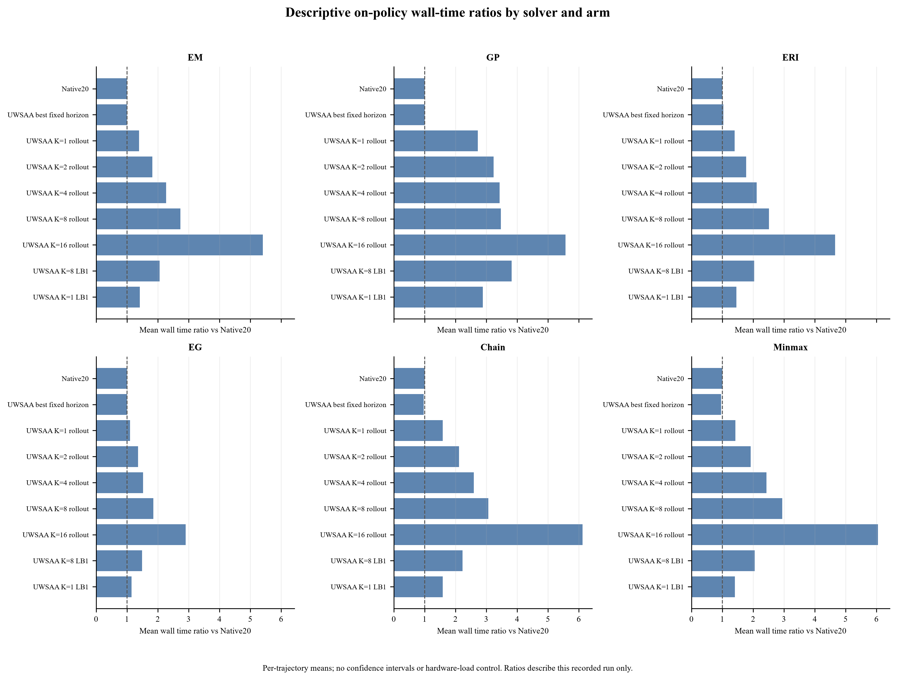

# UW-SAA benchmark results

This directory publishes reader-facing summary tables and plots for the registered UW-SAA evaluations. The row-level endpoint data, source-to-public mapping, and complete evidence-status inventory are in [`reproducibility/data/README.md`](../../reproducibility/data/README.md) and [`reproducibility/data_inventory.json`](../../reproducibility/data_inventory.json). The endpoint gzip is published as verified ordered parts because the complete file is larger than the repository file-size limit.

The MAIN evaluation contains 840 layouts in 21 geometry groups (40 layouts per geometry), 41 registered conditions, six solvers, and the UWSAA and NATIVE20 arms. The accepted Caserta ablation has six additional UWSAA arms over seven registered conditions; its UWSAA and NATIVE20 reference rows are reused from MAIN and are identified through the endpoint table's `study_membership` field. The deterministic-single evaluation has its own arm, `UWSAA_DETERMINISTIC_SINGLE`; it is not the K=1 rollout. The separately completed scenario ablation includes six newly executed arms and the reused K=8 rollout reference. Their exact matrix counts and provenance are recorded in the data inventory.

Caserta is the sealed evaluation benchmark for UW-SAA, held out from UW-SAA method development. Public availability and prior use by other project methods do not change this method-specific evaluation role.

## Metrics and uncertainty

The primary endpoint is **relocations**: lower counts are better. In source tables this was named `R_raw`; the public tables use `relocations`. The companion `R_over_N` metric is published as `relocations_per_container`. A condition suffix `repeat=0/1` identifies the repeat replicate; it is separate from relocation counts. Geometry and layout fingerprints are preserved exactly for reproducible bootstrap ordering.

The primary-comparison table reports relative reduction in percent, with positive values favoring the candidate. Condition-effect tables include both `relocations` and `relocations_per_container`; their estimates and interval bounds are proportions, not percentages. Existing blank interval fields remain blank. The published data preserve source numeric text, and the summary tables were checked cell by cell for exact numeric-text equality after public label and header normalization.

The accepted primary-comparison table contains MAIN against NATIVE20, six Caserta ablation comparisons, and the deterministic-single comparison. It retains the existing ordinary and adjusted confidence intervals. For the B=5 single-window ablation, the ordinary 95% interval is [-0.328%, -0.026%], while the adjusted 98.75% interval is [-0.370%, +0.012%] and crosses zero. This does not support a claim that UWSAA beats every single-window baseline.

On MAIN CLEAN, the registered 1% noninferiority test passed for MEAN6. The all-six-solver Bonferroni noninferiority gate failed; ERI alone met that conservative gate. The per-solver estimates and available intervals are retained in the condition-effects table.

The deterministic-single table includes all seven registered conditions and all six solvers plus MEAN6. Its noisy-family aggregate relative reduction in relocations is 5.633% (ordinary paired 95% CI [5.415%, 5.855%]). On CLEAN, the MEAN6 contrast is -2.657% (ordinary 95% CI [-2.985%, -2.322%]); all six solver estimates are negative. No noninferiority test was registered for this comparison. Positive values in its condition plot favor the UWSAA K=8 rollout over deterministic single.

Timing in `uwsaa_rollout_vs_deterministic_timing.csv` is descriptive on-policy timing. It reports means, p95 values, counts, and sums for actor selection and full-trajectory wall time. It has no confidence intervals and is not a matched-state speedup comparison.


## Scenario ablation and cost measurements

The accepted seven-condition scenario ablation adds 211,680 endpoint rows across six executed arms and reuses 35,280 K=8 rollout reference rows, for 246,960 matrix rows. Its public primary table contains seven registered contrasts summarized for all six solvers and MEAN6 (49 rows); condition-effect and geometry-outcome tables retain the registered conditions and layout-level outcomes. Existing estimates and confidence intervals are preserved. The source mapping, validation record, and detailed artifact hashes are in [`reproducibility/artifacts/scenario-ablation/uwsaa_scenario_ablation_manifest.json`](../../reproducibility/artifacts/scenario-ablation/uwsaa_scenario_ablation_manifest.json).

The accompanying cost measurements are descriptive on-policy outputs. The trajectory-level table has 317,520 rows, and the decision-selection timing payload has 11,325,741 rows. These measurements have no confidence intervals and do not establish controlled-hardware speedup. The decision timing gzip is split into five ordered parts; reassemble and verify it from the repository root with:

```text
python reproducibility/data/reassemble_endpoints.py --index results/uwsaa-benchmark-evaluation/data/uwsaa_cost_decision_select_seconds.parts.json --output <path>/uwsaa_cost_decision_select_seconds.csv.gz
```

Scenario and cost plots are available as PNG and vector PDF:

- [Scenario ablation pairwise (PNG)](figures/uwsaa_scenario_ablation_pairwise.png) · [PDF](figures/uwsaa_scenario_ablation_pairwise.pdf)
- [Scenario absolute interaction (PNG)](figures/uwsaa_scenario_ablation_absolute_interaction.png) · [PDF](figures/uwsaa_scenario_ablation_absolute_interaction.pdf)
- [Descriptive cost wall-time ratio (PNG)](figures/uwsaa_cost_wall_time_ratio.png) · [PDF](figures/uwsaa_cost_wall_time_ratio.pdf)







The scenario-ablation and cost figures can be regenerated from the repository root with Matplotlib and NumPy:

```text
python results/uwsaa-benchmark-evaluation/scripts/generate_scenario_figures.py
```

## Files

| File | Contents |
| --- | --- |
| `data/accepted_primary_contrasts_all_solvers.csv` | 56 accepted solver and MEAN6 comparisons |
| `data/caserta_main_condition_effects.csv` | All retained MAIN condition statistics for both relocation metrics |
| `data/caserta_ablation_condition_effects.csv` | All retained ablation condition statistics for both relocation metrics |
| `data/deterministic_single_condition_solver_results.csv` | Seven conditions × six solvers plus MEAN6 |
| `data/uwsaa_rollout_vs_deterministic_timing.csv` | Descriptive timing summaries, including MEAN6 |
| `data/scenario_ablation_primary_contrasts_all_solvers.csv` | All registered scenario-ablation primary contrasts by solver and MEAN6 |
| `data/scenario_ablation_condition_effects.csv` | Registered scenario-ablation condition effects |
| `data/scenario_ablation_geometry_outcomes.csv` | Geometry-level scenario-ablation outcomes |
| `data/uwsaa_cost_*.csv` and `data/uwsaa_cost_trajectory_rows.csv.gz` | Descriptive solver/arm costs, registered-condition costs, and trajectory timing |
| `data/uwsaa_cost_decision_select_seconds.parts.json` plus five parts | Split decision-selection timing payload and assembly metadata |
| `figures/` | PNG and vector PDF figures regenerated from the included CSV files |
| `scripts/generate_figures.py` and `scripts/generate_scenario_figures.py` | Recreate the accepted and scenario/cost figures from published CSV files |
| `source_hash_manifest.json` | Public artifact hashes and source-payload hashes without local paths |
| `reproducibility/artifacts/scenario-ablation/uwsaa_scenario_ablation_manifest.json` | Detailed source-to-public mapping and validation for scenario and cost artifacts |

To regenerate the summary figures from the repository root, install Matplotlib and NumPy, then run:

```text
python results/uwsaa-benchmark-evaluation/scripts/generate_figures.py
```

The complete endpoint data include all available endpoint columns and neutral row lineage. Full step-by-step action traces remain in the local archive and are not part of the public data layer.